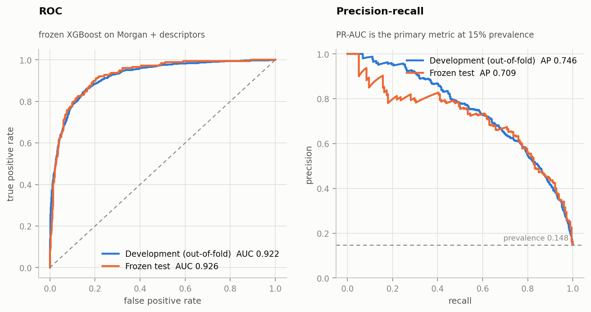
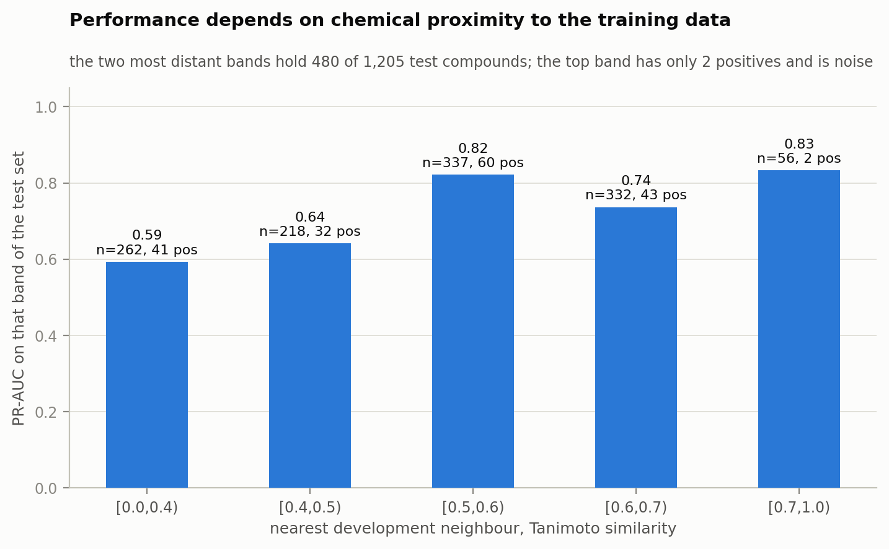
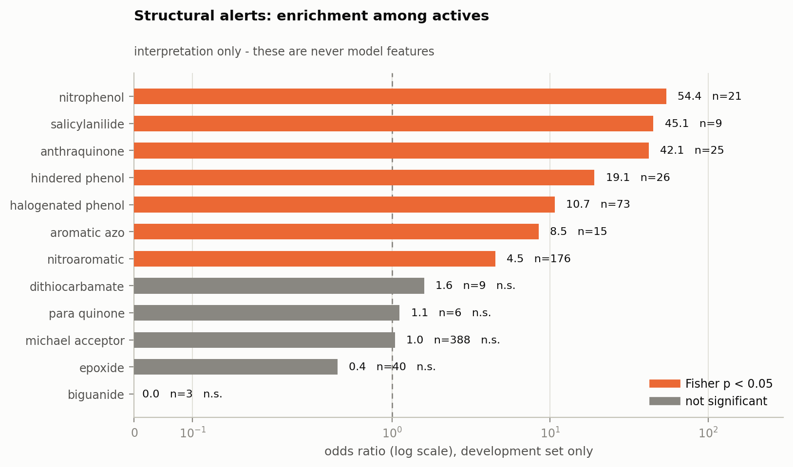
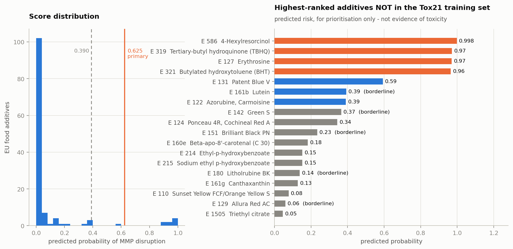

# Mitochondrial toxicity prediction from molecular structure

A QSAR classifier for mitochondrial membrane potential (MMP) disruption, trained on the Tox21
high-throughput screen and evaluated once on a frozen, analogue-disjoint test set. The
repository contains the model, its validation, and a screen of the 339 additives on the EU
Union list. Every compound that could not be resolved to a structure, or could not legitimately
be scored, is counted and given a reason.

**Frozen test set (1,205 compounds, never used for any modelling decision):**

| metric | value | 95% CI |
|---|---|---|
| PR-AUC (primary) | **0.709** | [0.638, 0.775] |
| ROC-AUC | 0.926 | [0.906, 0.944] |
| MCC | 0.612 | [0.544, 0.677] |
| sensitivity / specificity | 0.629 / 0.954 | — |

Class prevalence is 14.8%, so a no-skill classifier scores PR-AUC ≈ 0.148.

---

## Why mitochondrial toxicity, and why food additives

The FDA's Redbook sets out a tiered, exposure-based framework for the safety testing of food
additives. Mitochondrial function is not among the endpoints it requires. Meanwhile a scattered
experimental literature reports mitochondrial effects for specific permitted additives:

* BHA (E320) depresses respiration and raises mitochondrial ROS in perfused rat liver
  (Pateis et al., 2018).
* Aspartame together with potassium sorbate increases mitochondrial ROS and triggers p53
  activation and apoptosis in HepG2 cells (Qu et al., 2019).
* Co-exposure to E341 and E551 is cytotoxic to human mesenchymal stem cells
  (Athinarayanan et al., 2023).

Each of these is a single study on one compound or one pair. Running the same experiments
across an entire authorised inventory is not practical, which is the usual argument for
computational prioritisation. Machine-learning models for mitochondrial toxicity exist for
drug-like chemistry (Hemmerich et al., 2020), and QSAR has been applied to the genotoxicity of
food additives (Yang et al., 2009). Neither covers this endpoint on this chemical space.

This repository is a first pass at that gap. It builds a model for the Tox21 membrane-potential
endpoint, validates it as carefully as the data allows, and applies it once to the EU
authorised list.

### What this is not

This is not evidence that any additive is unsafe. The output is a ranked list of which
authorised substances would be worth putting in front of a Seahorse analyser first. Every
prediction is a computational prioritisation for further testing. Nothing here supports a
safety or regulatory claim about any compound.

---

## Decisions that changed the result

The model is an ordinary gradient-boosted tree on ordinary fingerprints. The curation and the
validation design are where the work is. Five decisions changed the outcome, and each one is
reproducible from a script here.

### 1. Two apparently independent data sources turned out to be one

The original plan combined Tox21 with the MitoTox database. Tracing MitoTox's
membrane-potential records back to their source papers showed that 1,861 of its 1,997 MMP
records (93.2%) come from Xia et al. 2018, the Tox21 10K follow-up study. MitoTox is largely a
curated annotation layer over the same screen, and it holds only the ~622 prioritised hits, not
the screening population. Treating the two as independent would have double-counted 619
compounds and manufactured cross-source agreement. MitoTox was dropped as a training source.
See `scripts/inspect_mitotox_provenance.py`.

### 2. The meaning of "Active" was read off the data, not inferred from the assay title

The assay is called *"qHTS assay for small molecule disruptors of the mitochondrial membrane
potential"*, which is directionally neutral. The underlying fields are not.
`PUBCHEM_ACTIVITY_OUTCOME = Active` corresponds exactly to `Activity Summary = 'active
antagonist'` (1,260 against 1,260, no leakage either way). All 1,260 actives have negative ratio
efficacy, median −92.4%. The 297 compounds that *increase* membrane potential are classified
Inconclusive by NCATS and never enter the positive class. The label means depolarisation
specifically. See `scripts/inspect_tox21_raw.py`.

### 3. The textbook scaffold split was unusable, and the diagnostic is kept in the repo

Bemis–Murcko scaffold splitting produced a 34-compound test set containing 1 positive. The
cause is in the data: 1,167 compounds, 19.7% of the dataset, share the scaffold `c1ccccc1`, and
24.6% are acyclic with no scaffold at all. On a diverse industrial-chemical library, sharing a
Murcko scaffold stops being a useful proxy for being an analogue. Taylor–Butina clustering at
Tanimoto ≥ 0.70 was used instead. Both groupings are implemented, and `--grouping murcko`
reproduces the failure. See `scripts/make_splits.py`.

### 4. The decision threshold was fixed before the test set was touched

It was chosen by maximising MCC on grouped out-of-fold development predictions. The same model
scores PR-AUC 0.9997 in-sample, because it reproduces its own training labels almost perfectly.
A threshold picked from in-sample predictions therefore lands far too high, and the model then
looks insensitive on the test set for reasons that have nothing to do with its ranking ability.
The threshold transferred to the frozen test set within 0.006 MCC.

### 5. The headline number depends on the dependency versions

Re-running the frozen evaluation under a different XGBoost minor version gives test PR-AUC
0.6825 instead of 0.7090 and moves 35 of the 1,205 compounds across the decision threshold. No
predicted probability is identical between the two environments. The selection stage, which
reads only stored out-of-fold predictions, reproduces byte-for-byte in both, which locates the
difference in the refit rather than anywhere in this code.

The shift is small relative to the bootstrap 95% CI on the same metric, [0.638, 0.775], a width
of 0.137. Both environments rank all 108 candidate configurations identically and sit far above
the 0.148 no-skill baseline. The conclusion holds where the digits do not, and quoting 0.709
without naming the environment would overstate what was measured. Figures in
`results/reproduction_check.txt`.

---

## The endpoint

**Source:** [PubChem AID 720637](https://pubchem.ncbi.nlm.nih.gov/bioassay/720637), *qHTS assay
for small molecule disruptors of the mitochondrial membrane potential: Summary* (U.S. Tox21
Program / NCATS). HepG2 cells, ratiometric membrane-potential dye (m-MPI).

This is a summary assay. It combines the MMP readout
([AID 720635](https://pubchem.ncbi.nlm.nih.gov/bioassay/720635)) with a cell-viability
counterscreen ([AID 720634](https://pubchem.ncbi.nlm.nih.gov/bioassay/720634)) measured in the
same wells. Compounds showing excessive cytotoxicity are routed to Inconclusive rather than
Active, so the viability correction already sits inside the hit call. AID 720634 is carried
here as annotation and QC only. It never modifies a label.

```
label 1  =  Activity Outcome "Active"      (= "active antagonist", MMP decrease)
label 0  =  Activity Outcome "Inactive"
excluded =  "Inconclusive"   retained and flagged, never coerced into a class
```

## Dataset construction


```
10,486 Tox21 sample records (SIDs)     149 have neither CID nor structure
 8,099 unique compounds (CIDs)         duplicate vendor lots collapsed
 7,575 standardised parent structures  RDKit; salts and counter-ions stripped
 5,938 modelling compounds             898 positive / 5,040 negative (15.12%)
```

Every exclusion reconciles at both the compound and the parent level:

| excluded | parents | why |
|---|---|---|
| Inconclusive only | 1,527 | no usable call |
| inorganic parent | 50 | carbon-free, outside any QSAR applicability domain |
| CID-level conflict | 44 | one vendor lot Active, another Inactive |
| parent-level conflict | 15 | conflict created only after salt stripping |
| unparseable parent | 1 | six metallocenes collapse to an invalid `c1cccc1` |

Nothing is discarded. All 10,486 observations remain in
`data/processed/tox21_mmp_observations.csv` and all 1,637 excluded parents in
`tox21_mmp_excluded.csv`, flagged, with reasons, and carrying no label column.

Conflicts are excluded rather than resolved by majority vote. Of the 44 compound-level
conflicts, 34 are 1:1 ties that no vote could decide, and their Active calls are the weakest in
the dataset: median potency 40.1 µM against 14.4 µM overall, and three times more likely to sit
above 40 µM, which means fitted near the top of the tested concentration range.

### Structure standardisation

RDKit `rdMolStandardize`, in order: sanitise, `Normalizer`, `MetalDisconnector`,
`LargestFragmentChooser(preferOrganic=True)`, `Uncharger`, then canonical isomeric SMILES and
InChIKey.

Stereochemistry is never stripped. Of the 1,423 structures with assigned stereocentres, 1,414
retain them. The 9 apparent losses are chiral counter-ions (tartrate, malate, maleate) removed
correctly along with the salt.

Neutralisation affects 518 structures. The data justifies it: 1,240 of the 1,256 charged
structures are charge-balanced salt pairs, so the residual charge left after counter-ion removal
is an artefact of the pairing. RDKit's `Uncharger` preserves permanent charges, and 378
structures stay charged (quaternary ammoniums, imidazolium ionic liquids, N-oxides).

`src/mitotox/standardize.py` is the single shared function. It produced the training
`parent_smiles` column and it is what `predict.py` calls at prediction time.
`tests/test_standardization.py` re-derives all 8,099 stored parents from their depositor SMILES
and asserts an exact string match, so the prediction path cannot drift from the training path
without a test failing.

## Molecular representation

Specified before any modelling and not revised afterwards.

| block | setting |
|---|---|
| Morgan fingerprint | radius 2 (ECFP4-like), 2048 bits, binary, chirality on |
| MACCS keys | 167 structural keys (comparison representation) |
| descriptors | MolWt, MolLogP, TPSA, NumHDonors, NumHAcceptors, NumRotatableBonds |

Chirality is on because compounds are grouped by full InChIKey. Stereoisomers are therefore
separate compounds, and without it they would receive identical features.

Thirteen SMARTS structural alerts are computed but never used as model features
(`config.ALERTS_ARE_MODEL_FEATURES = False`). They exist for post-hoc interpretation. Each
holds a *tuple* of patterns rather than a comma-joined string, because SMARTS uses commas inside
brackets for atom-level OR, and splitting a pattern on `,` corrupts it without any error.
`tests/test_structural_alerts.py` checks every alert against a reference molecule that must
match and several that must not. It caught a broken biguanide pattern that metformin did not
match, which would otherwise have looked identical to there being no biguanides in the library.

## Validation design

The split is analogue-disjoint rather than scaffold-disjoint: Taylor–Butina clustering of Morgan
fingerprints at Tanimoto ≥ 0.70, then `StratifiedGroupKFold` with seed 42 fixed in advance.

```
development   4,733 compounds    720 positive   15.21%
frozen test   1,205 compounds    178 positive   14.77%
```

Zero shared InChIKeys, zero shared SMILES, zero shared clusters, every compound assigned exactly
once. Each test compound's nearest-development-neighbour similarity is kept in
`data/processed/test_nn_similarity.csv`:

| NN Tanimoto | ≥ 0.60 | ≥ 0.70 | ≥ 0.80 | ≥ 0.90 | ≥ 0.99 |
|---|---|---|---|---|---|
| test compounds | 32.2% | 4.6% | 1.5% | 0.4% | 0% |

Five test compounds sit at ≥ 0.90. Butina clustering is leader-based, so a cluster singleton can
still be close to a non-leader elsewhere. They were not moved by hand: the grouping rule alone
determined the split. Murcko scaffolds are shared across the split by design, and forbidding
that is what broke the first attempt.

`StandardScaler` is applied to the six descriptor columns only, inside the `Pipeline`, and
fitted per training fold. No resampling, no SMOTE, no negatives deleted.

---

## Results

### Model comparison

A grid of 108 configurations was declared in `src/mitotox/models.py` before training: 3
molecular representations × (8 logistic regression + 12 random forest + 16 XGBoost) settings,
each fitted over 5 cross-validation folds, giving 540 fits. The primary metric is PR-AUC. All
figures below come from the development set.

Best configuration in each model family:

| model family | configs | CV PR-AUC | CV ROC-AUC | best representation |
|---|---|---|---|---|
| XGBoost | 48 | **0.748 ± 0.038** | 0.922 ± 0.016 | Morgan + descriptors |
| random forest | 36 | 0.732 ± 0.046 | 0.918 ± 0.016 | Morgan + descriptors |
| logistic regression | 24 | 0.625 ± 0.029 | 0.885 ± 0.021 | Morgan + descriptors |
| no-skill baseline | — | 0.148 | 0.500 | — |

Best PR-AUC for every family and representation pair:

| | Morgan only | Morgan + 6 descriptors | MACCS + 6 descriptors |
|---|---|---|---|
| logistic regression | 0.607 | 0.625 | 0.590 |
| random forest | 0.646 | 0.732 | 0.722 |
| XGBoost | 0.648 | **0.748** | 0.737 |

Averaged over all 36 configurations fitted on each representation: Morgan alone 0.600,
Morgan + descriptors 0.685, MACCS + descriptors 0.678.


The six physicochemical descriptors matter more than any other choice in the grid. Adding them
to Morgan moves the best XGBoost model from 0.648 to 0.748 and the best random forest from 0.646
to 0.732. Swapping Morgan for MACCS alongside the same descriptors costs 0.011, well inside the
fold-to-fold spread. Morgan alone was the primary representation in the original plan, and it is
the weakest of the three.

The ordering of model families is the conventional one for tabular features at this scale, and
the distances between them are uneven. Logistic regression sits 0.12 below XGBoost. Random
forest sits 0.015 below it, less than one fold-to-fold standard deviation. Class weighting
changed PR-AUC by no more than 0.005 in any family, so the imbalance is better handled by the
choice of metric and threshold than by reweighting.

The top four configurations span 0.7476 to 0.7391, all within one fold-to-fold standard
deviation of each other. The supportable claim is "XGBoost on Morgan + descriptors", not that
one exact hyperparameter setting is uniquely best.

**Selected and frozen:** XGBoost on Morgan + descriptors, `max_depth=6, learning_rate=0.1,
min_child_weight=1, scale_pos_weight=5.5736, n_estimators=400, subsample=0.8,
colsample_bytree=0.8, tree_method=hist, random_state=42`. CV PR-AUC **0.7476 ± 0.0377**.

### Frozen test set, scored exactly once




| | development (CV) | frozen test | gap |
|---|---|---|---|
| PR-AUC | 0.7476 ± 0.0377 | **0.7090** | +0.039 |
| ROC-AUC | 0.9220 ± 0.0164 | **0.9259** | −0.004 |
| MCC @ 0.625 | 0.6179 (OOF) | **0.6117** | +0.006 |

The PR-AUC gap is about one CV standard deviation, and the test value falls inside the CV fold
range of 0.715 to 0.795. ROC-AUC is marginally better on test than in cross-validation. The
confusion matrix at the primary threshold is 980 / 47 / 66 / 112.

Three thresholds were fixed on development out-of-fold predictions before the test set was
loaded. Bootstrap confidence intervals use 2,000 percentile resamples, seed 20260910.

| threshold | role | MCC | sensitivity | specificity | precision |
|---|---|---|---|---|---|
| **0.625** | primary (MCC-max) | 0.612 | 0.629 | 0.954 | 0.704 |
| 0.390 | sensitivity analysis (F1-optimal) | 0.627 | 0.747 | 0.924 | 0.630 |
| 0.163 | sensitivity analysis (Youden-J) | 0.564 | 0.848 | 0.846 | 0.489 |

The MCC surface is nearly flat between 0.390 and 0.625, 0.627 against 0.612, while sensitivity
differs sharply. The primary threshold was kept at its pre-registered value, since changing it
after seeing the test numbers would defeat the point of fixing it in advance. For a screening
application the 0.390 row is the more useful operating point, and it is reported for that
reason.

### Performance depends on chemical proximity



| nearest-neighbour Tanimoto | n | positives | PR-AUC |
|---|---|---|---|
| [0.0, 0.4) | 262 | 41 | 0.594 |
| [0.4, 0.5) | 218 | 32 | 0.642 |
| [0.5, 0.6) | 337 | 60 | 0.822 |
| [0.6, 0.7) | 332 | 43 | 0.737 |
| [0.7, 1.0) | 56 | 2 | 0.833 (only 2 positives, noise) |

The two most distant bands hold 480 of the 1,205 test compounds and score 0.59 to 0.64, against
0.74 to 0.82 for the closer ones. This is the most important caveat for any downstream screening
application, and it is why `predict.py` returns an applicability band alongside every score.

---

## Interpretation


Computed on the development set. Direction is the Spearman correlation between a feature's value
and its own SHAP contribution. Mean signed SHAP is not used: on a 15%-prevalence dataset its
sign is dominated by the majority class and can label a risk-increasing feature as protective.

`MolLogP` dominates (mean |SHAP| 1.394, ρ = +0.95), followed by `MolWt` (0.882, ρ = +0.87).
Actives average logP 3.77 against 1.94 for inactives, and 328 Da against 252 Da. TPSA, H-bond
donors and acceptors are nearly identical between the classes.

> This is an association consistent with a physicochemical difference between the classes. It is
> not evidence that membrane partitioning is the causal mechanism. The design used here cannot
> establish that.

### Structural alerts

Interpretation only, development split only.



| alert | n | odds ratio | Fisher p |
|---|---|---|---|
| nitrophenol | 21 | 54.4 | < 1e-13 |
| salicylanilide | 9 | 45.1 | < 1e-5 |
| anthraquinone | 25 | 42.1 | < 1e-14 |
| hindered phenol | 26 | 19.1 | < 1e-11 |
| halogenated phenol | 73 | 10.7 | < 1e-21 |
| nitroaromatic | 176 | 4.5 | < 1e-18 |
| **Michael acceptor** | **388** | **1.04** | **0.77 (n.s.)** |
| epoxide | 40 | 0.45 | 0.27 (n.s.) |

The enriched alerts are variations on one motif, a lipophilic weak acid, which aligns with the
logP signal. The negative result is the more informative one. Michael acceptors show an odds
ratio of 1.04 across 388 compounds, no signal at all, and epoxides are if anything depleted. For
a short-exposure ΔΨm readout that is coherent: the assay sees direct uncouplers, not slow
glutathione depletion. It is reported rather than dropped.

---

## Screening the EU additive list

Annex II Part B of Regulation (EC) No 1333/2008 was parsed to 339 authorised additives, resolved
to structures through PubChem, gated, and scored once with the frozen model. Results are in
`results/tables/efsa_additive_screen.csv` and `results/efsa_screen_accounting.txt`.

| step | n | |
|---|---|---|
| additives in the Union list | 339 | Annex II Part B |
| resolved to a validated structure | 202 | 174 by E number **and** name, 28 by exact full name |
| not resolved | 137 | recorded with a reason each |
| excluded before scoring | 73 | 48 carbon-free, 19 variable composition, 4 inorganic carbon, 2 larger than anything in training |
| **screened** | **129** | reconciles: 202 − 73 |
| &nbsp;&nbsp;already in the Tox21 training set | 72 | fitted values, **not** predictions |
| &nbsp;&nbsp;genuinely out-of-sample | 57 | |



Eight of the 129 clear the primary threshold of p ≥ 0.625, four of them out-of-sample. The
highest-ranked compounds the model had not seen are 4-hexylresorcinol (0.998), TBHQ (0.971),
erythrosine (0.970) and BHT (0.965), all within the applicability domain. BHA, curcumin, propyl
gallate and quinoline yellow also rank at the top, but they are in the training set, so their
scores are fitted values and the table marks them as such.

The phenolic antioxidants surfacing first is consistent with the published mitochondrial
literature. It is a consistency check rather than independent validation, since those compounds
sit in or near the chemistry the model was trained on.

### Scope gates

Three gates run before anything is scored, and every exclusion is counted and reconciled.

Substances of variable composition (polymers, gums, modified starches, extracts, plural class
names) are excluded because no single structure represents them. A representative CID for
xanthan gum is not xanthan gum.

Inorganic carbon species (carbonate, CO₂, cyanide) are excluded by substructure together with a
size bound. A rule as loose as "contains a carbon atom" would let calcium carbonate through.
Urea passes, as it should.

Anything heavier than the largest molecule in the training set, 1,701 Da, is excluded. That
removes nisin at 3,354 Da and lysozyme. A small-molecule fingerprint does not describe objects
of that size, and the applicability band on its own would report them in the same words as an
ordinary near-neighbour miss.

### A defect found by the repository's own audit

The first version of the structure resolver accepted a PubChem compound if its synonym list
contained the additive's E number. That rule is not specific enough. Supplier catalogue codes of
the form `E-1404` are common, and once punctuation is stripped they are indistinguishable from a
food-additive E number. The failure was also circular: PubChem's name search returns those same
catalogue entries, and the validation step then confirmed them against the synonym that had
produced the hit.

29 of 248 resolved structures were wrong. Erlotinib Hydrochloride for E 1404 (oxidised starch),
Spiperone for E 525 (potassium hydroxide), Androstenone for E 282 (calcium propionate). Had the
screen been run on that output, a cancer drug would have appeared in a table of food additives.

Validation now requires two independent lines of evidence: the E number *and* the name, or an
exact match to the full Union-list name. Under the new rule 24 of the 29 were rejected or gated
out and 5 re-resolved correctly. A standing audit compares every resolved structure's PubChem
title against its Union-list name (`scripts/audit_additive_resolution.py`), and substances that
cannot have a single structure are excluded by name before scoring rather than represented by an
arbitrary member (`src/mitotox/additives.py`, with 82 controls in
`tests/test_additive_gates.py`).

---

## Using the model

```bash
python scripts/predict.py --smiles "CC(C)(C)c1cc(C)cc(C(C)(C)C)c1O"

python scripts/predict.py --input examples/example_input.csv \
                          --name-column name \
                          --output results/tables/my_predictions.csv
```

Example output on common food additives (`examples/example_output.csv`):

```
name                                     std. SMILES                     prob  class  applicability   NN    in training
2,4-Dinitrophenol (reference uncoupler)  O=[N+]([O-])c1ccc(O)c([N+]...  0.988    1    within domain  1.00     YES
Dodecyl gallate (E312)                   CCCCCCCCCCCCOC(=O)c1cc(O)...  0.973    1    within domain  1.00     YES
TBHQ (E319)                              CC(C)(C)c1cc(O)ccc1O          0.971    1    within domain  0.59      no
BHT (E321)                               Cc1cc(C(C)(C)C)c(O)c(C(C)...  0.965    1    within domain  0.68      no
Curcumin (E100)                          COc1cc(C=CC(=O)CC(=O)C=Cc...  0.808    1    within domain  0.68      no
Tartrazine (E102)                        CC1=NN(c2ccc(S(=O)(=O)O)c...  0.018    0    within domain  0.89      no
Aspartame (E951)                         COC(=O)C(Cc1ccccc1)NC(=O)...  0.005    0    within domain  0.62      no
Sucrose                                  OCC1OC(OC2(CO)OC(CO)C(O)C...  0.003    0   outside domain  0.29      no
Potassium sorbate (E202)                 CC=CC=CC(=O)O                 0.001    0   outside domain  0.38      no
Silicon dioxide (E551)                   O=[Si]=O                        —      —   NOT SCORED: inorganic parent
```

Three safeguards are built into every prediction.

* An **applicability band** from the nearest training neighbour, with cut-offs taken from the
  measured per-band test performance above rather than chosen.
* **Training-set membership.** DNP, dodecyl gallate, propyl gallate, sodium benzoate and citric
  acid are in the training set, so those rows are fitted values and the output says so. BHT and
  TBHQ are genuine out-of-sample predictions.
* **Structural refusals.** Inorganic parents, unparseable structures and standardisation
  failures return a reason instead of a number. Salt stripping and mixture handling raise
  warnings.

## Reproducing

```bash
pip install -r requirements.txt

python scripts/download_tox21.py                    # PubChem AID 720637 + 720634
python scripts/build_tox21_dataset.py               # curated dataset
python scripts/build_features.py                    # fingerprints + descriptors
python scripts/make_splits.py                       # Butina split, seed 42
python scripts/train_models.py                      # 540 CV fits  (~25 min, 2 cores)
python scripts/select_model.py                      # winner + threshold from OOF
python scripts/final_test_eval.py                   # frozen test, scored once
python scripts/save_final_model.py                  # models/final_model.joblib
python scripts/build_applicability_reference.py
python scripts/interpret_model.py                   # SHAP + alert enrichment
python scripts/make_figures.py

# the EU additive screen (the resolver needs internet; nothing else does)
python scripts/download_efsa_additives.py           # Regulation (EC) No 1333/2008
python scripts/parse_efsa_additives.py              # Annex II Part B -> 339 additives
python scripts/resolve_additive_structures.py       # PubChem, two-evidence validation
python scripts/audit_additive_resolution.py         # standing title-vs-name check
python scripts/screen_additives.py                  # scope gates, then score once

python tests/test_standardization.py                # prediction path == training path
python tests/test_structural_alerts.py              # SMARTS positive/negative controls
python tests/test_additive_gates.py                 # scope gates, 82 controls
python tests/test_efsa_parser.py                    # Annex II parsing
python tests/test_download_pagination.py            # downloader, against a mock API
```

`resolve_additive_structures.py` caches PubChem name searches, synonym lists and properties on
disk, so changing the validation rule and re-deciding costs no network at all. Use `--rebuild`
after a rule change.

**Reproduction.** Re-running `scripts/select_model.py` and `scripts/final_test_eval.py` from the
committed inputs, in the pinned environment of `requirements.txt` (Python 3.10.12,
scikit-learn 1.7.2, xgboost 3.2.0), reproduces all five output files byte-for-byte. Verified
16 November 2026.

In a newer environment with nothing pinned (Python 3.13.16, scikit-learn 1.9.1, xgboost 3.4.1)
the selection stage is still byte-identical, but the refit is not: test PR-AUC 0.6825 against
0.7090, MCC 0.576 against 0.612, and 35 of the 1,205 test compounds change class at the primary
threshold. The difference is attributable to XGBoost. The selection stage reads only stored
out-of-fold predictions and reproduces exactly, while the stage that fits an `XGBClassifier`
does not, across an XGBoost minor version. `requirements.txt` is a requirement, not a
convenience.

The shift is small against the bootstrap 95% CI on the same metric, [0.638, 0.775], width 0.137.
Both environments put the model far above the 0.148 no-skill baseline and rank the 108 candidate
configurations identically, so the conclusion holds where the digits do not. Full figures in
`results/reproduction_check.txt`.

An earlier version of this README claimed bit-identical reproduction across Python and
scikit-learn versions. That claim did not survive being checked, and has been replaced by the
measured figures above.

## Repository layout

```
src/mitotox/
  config.py           every constant: fingerprint settings, seed, split parameters
  standardize.py      the shared standardisation function
  features.py         Morgan, MACCS, descriptors
  splits.py           Murcko and Butina grouping
  models.py           pre-registered search space and reporting constraints
  predict.py          the predictor, with applicability domain
  interpretation.py   13 SMARTS alerts (never features)
  additives.py        scope gates: variable composition, inorganic carbon

scripts/              one entry point per pipeline stage, runnable in the order above
tests/                standardisation contract, SMARTS controls, scope gates,
                      Annex II parser, downloader
data/processed/       curated datasets, features, splits  (committed)
data/external/        raw API downloads                    (gitignored; see data/README.md)
results/              checkpoint reports, tables, figures
models/               frozen model + applicability reference
examples/             example input and output for predict.py
```

## Limitations

* **Single endpoint, single cell line, single time point.** HepG2, short exposure. This predicts
  an acute in-vitro ΔΨm readout and nothing more.
* **Performance degrades away from the training chemistry**, from 0.82 PR-AUC near Tanimoto
  0.5–0.6 down to 0.59 below 0.4. Food additives chemically unlike the Tox21 library should be
  trusted least, and those are exactly the compounds a screening application most wants to know
  about.
* **Salt stripping merges metal complexes with their alkali salts.** Zinc dithiocarbamate
  (ziram, Active) collapses onto sodium dithiocarbamate (Inactive), and 129 of 330
  multi-compound parents merge differing metal content. These are kept with `flag_metal_removed`
  rather than excluded, but for an organometallic the parent is not the same chemical entity.
* **336 true mixtures** had a real co-formulated component discarded by largest-fragment
  selection. Flagged, not silently dropped.
* **103 Inconclusive compounds sit inside labelled parents**, sharing a parent structure with a
  consistent compound. This is correct under the stated rule, but it means "1,688 Inconclusive
  excluded" and "103 Inconclusive inside labelled parents" are both true at different levels.
* **Minor pre-registration deviation.** During cross-validation `scale_pos_weight` was derived
  from the whole development set rather than per training fold: 5.5736 against per-fold values
  of 5.5729 to 5.5764, a maximum deviation of 0.05%. It does not touch the test set.
* **The test set is spent.** It has been scored once. No further decision in this repository may
  be informed by it.
* **137 of 339 additives could not be resolved to a validated structure**, and 73 more were
  resolved but excluded as unscoreable. The screen covers 129 additives, not the Union list.
  Every exclusion is counted with a reason, but a name the resolver cannot confirm is a gap in
  coverage, not a finding about the substance.
* **72 of the 129 screened additives are already in the training set.** Their scores are fitted
  values and are marked as such. Only 57 are genuine out-of-sample predictions, so the screen is
  a smaller test of the model than its headline count suggests.
* **The screen recovering the known phenolic antioxidants is not independent validation.** Those
  compounds are in or close to the training chemistry.
* **Substances of variable composition are out of scope**, which is not the same as having been
  examined and found unremarkable. Polymers, gums, modified starches and extracts are excluded
  because no single structure represents them, and the screen says nothing about them.
* **No dose or exposure context.** A qHTS Active call says nothing about whether the
  concentration is reachable through diet. Any real risk statement needs the exposure half,
  which is where the Redbook's tiered framework already operates.
* **Predictions are computational prioritisation, not experimental evidence.** Nothing here
  supports a regulatory or safety claim about any compound.

## Next stage

The EU screen is done. Three things would extend it, ordered by how much they would change the
answer.

1. **A second endpoint.** The Tox21 viability counterscreen (AID 720634) is already downloaded
   and used here only for QC. Modelling it alongside MMP would separate uncoupling from general
   cytotoxicity, which is the largest ambiguity in what a positive prediction currently means.
2. **Mixture effects.** Every motivating study of additive mitochondrial toxicity concerns
   combinations, while the model scores one compound at a time. This is the widest gap between
   what the model does and what the question asks.
3. **The other regulatory lists.** FDA (EAFUS) and FSSAI (INS) publish names and identifiers but
   no structures, so each needs the same two-evidence resolution and the same accounting the EU
   list received. The resolver generalises; the name vocabulary in `additives.py` would need
   extending, and its 82 controls are where that extension gets checked.

The 137 unresolved EU additives are worth a second pass. Most are genuinely structureless
(mixtures, extracts, inorganic salts), but each is recorded with a reason and that list has not
been read compound by compound.

---

## References

### Mitochondrial effects of food additives

* Pateis, V.O. et al. (2018) The food additive BHA modifies energy metabolism in the perfused
  rat liver. *Toxicology Letters* 299, 191–200.
* Qu, D. et al. (2019) Synergistic effects of the enhancements to mitochondrial ROS, p53
  activation and apoptosis generated by aspartame and potassium sorbate in HepG2 cells.
  *Molecules* 24, 457.
* Athinarayanan, J. et al. (2023) Co-exposure to commercial food product ingredient E341 and
  E551 triggers cytotoxicity in human mesenchymal stem cells. *Environmental Science and
  Pollution Research* 30, 33264–33274.
* Kakade, S.S. et al. (2024) Effects of common food additives on HepG2 cells. *ES Food and
  Agroforestry* 17, 1142.
* Niu, Y., Fan, Y., Zhang, J. (2025) Progress and challenge in the risk management of food
  additives. *Journal of Food Protection* 88, 100607.

### Computational toxicology for this endpoint

* Hemmerich, J., Troger, F., Füzi, B., Ecker, G.F. (2020) Using machine learning methods and
  structural alerts for prediction of mitochondrial toxicity. *Molecular Informatics* 39,
  2000005.
* Yang, C., Valerio, L.G., Arvidson, K.B. (2009) Computational toxicology approaches at the
  US Food and Drug Administration. *ATLA* 37, 523–531.

### Data sources

* Tox21 qHTS MMP assay, PubChem
  [AID 720637](https://pubchem.ncbi.nlm.nih.gov/bioassay/720637),
  [720635](https://pubchem.ncbi.nlm.nih.gov/bioassay/720635),
  [720634](https://pubchem.ncbi.nlm.nih.gov/bioassay/720634). U.S. Tox21 Program
  (NCATS / EPA / NIEHS-NTP / FDA).
* Attene-Ramos, M.S. et al. (2015) Profiling of the Tox21 chemical collection for mitochondrial
  function to identify compounds that acutely decrease mitochondrial membrane potential.
  *Environmental Health Perspectives*, doi
  [10.1289/ehp.1408642](https://doi.org/10.1289/ehp.1408642). The primary MMP screen.
* Xia, M. et al. (2018) Comprehensive analyses and prioritization of Tox21 10K chemicals
  affecting mitochondrial function. *Environmental Health Perspectives*, doi
  [10.1289/EHP2589](https://doi.org/10.1289/EHP2589). The follow-up study that constitutes 93%
  of MitoTox's MMP content.
* Zhang, H. et al. (2021) MitoTox: a comprehensive mitochondrial toxicity database.
  *BMC Bioinformatics* 22:369. [mitotox.org](http://www.mitotox.org/). Downloaded and analysed
  for provenance; not used as a training source.
* Seal, S. et al. (2022) Comparison of cellular morphological descriptors and molecular
  fingerprints for the prediction of cytotoxicity- and proliferation-related assays.
  *Communications Biology*, doi
  [10.1038/s42003-022-03763-5](https://doi.org/10.1038/s42003-022-03763-5). Documents the
  720635 / 720634 / 720637 relationship.
* Huang, R. et al. (2016) Tox21Challenge to build predictive models of nuclear receptor and
  stress response pathways as mediated by exposure to environmental chemicals and drugs.
  *Frontiers in Environmental Science* 3, 85.
* Regulation (EC) No 1333/2008 on food additives, Annex II Part B, the Union list of authorised
  food additives.

### Methods and software

* Bemis, G.W., Murcko, M.A. (1996) The properties of known drugs. 1. Molecular frameworks.
  *Journal of Medicinal Chemistry* 39, 2887–2893. The scaffold definition used in the split
  diagnostic.
* Butina, D. (1999) Unsupervised database clustering based on Daylight's fingerprint and
  Tanimoto similarity. *Journal of Chemical Information and Computer Sciences* 39, 747–750. The
  clustering used for the analogue-disjoint split.
* Rogers, D., Hahn, M. (2010) Extended-connectivity fingerprints. *Journal of Chemical
  Information and Modeling* 50, 742–754.
* Chen, T., Guestrin, C. (2016) XGBoost: a scalable tree boosting system. *Proceedings of KDD
  '16*, 785–794.
* Lundberg, S.M., Lee, S.-I. (2017) A unified approach to interpreting model predictions.
  *Advances in Neural Information Processing Systems* 30.
* Saito, T., Rehmsmeier, M. (2015) The precision-recall plot is more informative than the ROC
  plot when evaluating binary classifiers on imbalanced datasets. *PLOS ONE* 10, e0118432. The
  basis for using PR-AUC as the primary metric here.
* RDKit: open-source cheminformatics. [rdkit.org](https://www.rdkit.org/)

## Licence

MIT, see [LICENSE](LICENSE). Tox21 data is public-domain U.S. government work. Raw downloads are
not redistributed here; see `data/README.md`.
