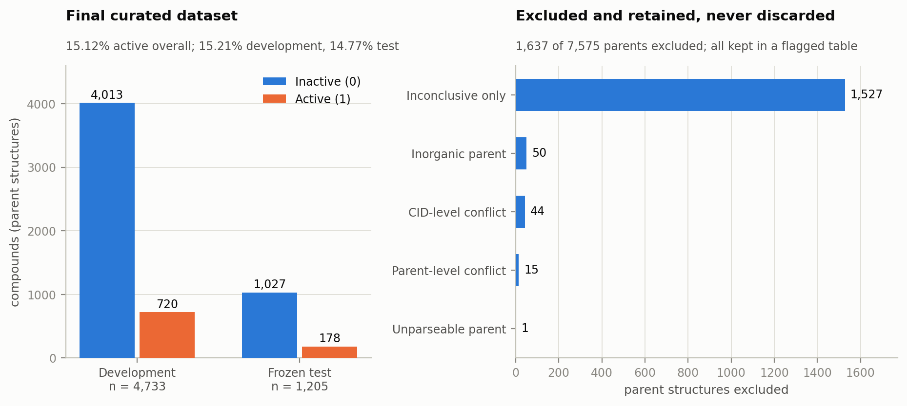
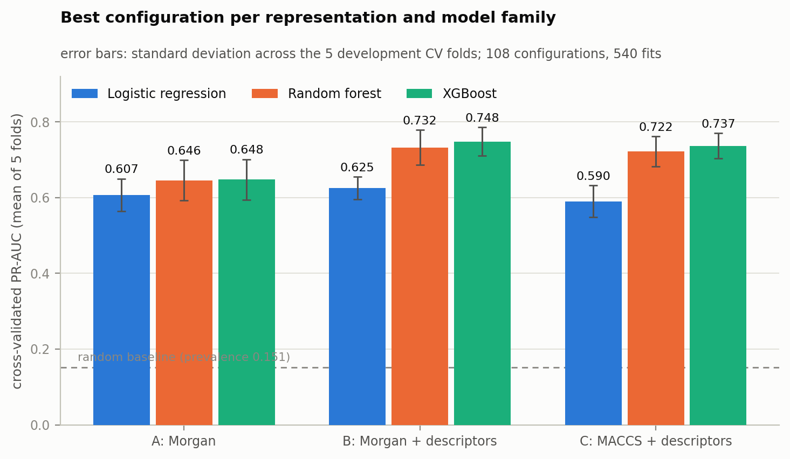
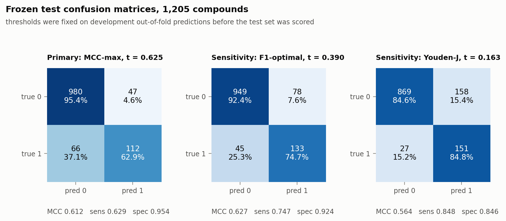
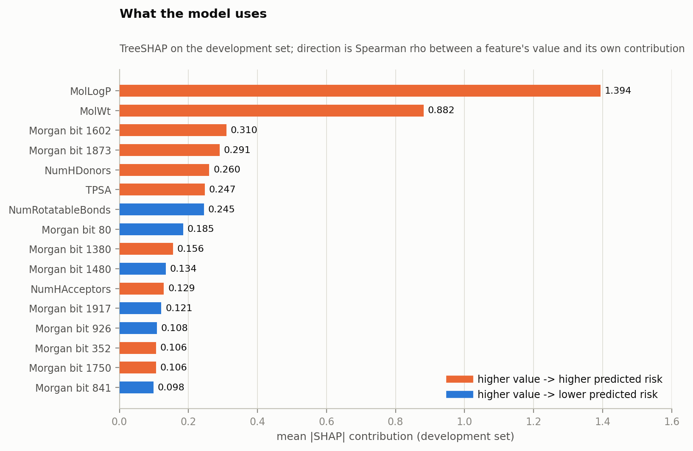

# Mitochondrial toxicity prediction from molecular structure

A QSAR classifier for **mitochondrial membrane potential (MMP) disruption**, built on the
Tox21 high-throughput screen and validated on a frozen, analogue-disjoint test set.

Built as the modelling foundation for a larger question — *can molecular structure be used
to prioritise approved food additives for mitochondrial-toxicity testing?* — which is not a
required endpoint in the FDA Redbook battery. This repository contains the model, its
validation, and a screen of the 339 additives on the EU Union list — with every compound
that could not be resolved or could not legitimately be scored counted and given a reason.

**Frozen test set (1,205 compounds, never used for any modelling decision):**

| metric | value | 95% CI |
|---|---|---|
| PR-AUC (primary) | **0.709** | [0.638, 0.775] |
| ROC-AUC | 0.926 | [0.906, 0.944] |
| MCC | 0.612 | [0.544, 0.677] |
| sensitivity / specificity | 0.629 / 0.954 | — |

Class prevalence is 14.8%, so a random classifier scores PR-AUC ≈ 0.148.

## Project status

**Complete and validated — the Tox21 MMP model.** Curation, analogue-disjoint splitting,
the pre-registered 108-configuration search (540 fits), threshold selection on development
out-of-fold predictions, a single frozen test evaluation, interpretation, and the frozen
predictor. Reproduced byte-for-byte in the pinned environment; see
`results/reproduction_check.txt`.

**Complete — the EU food-additive screen.** Annex II Part B of Regulation (EC)
No 1333/2008 parsed to 339 authorised additives, resolved to structures through PubChem,
gated, and scored once with the frozen model. Results in
`results/tables/efsa_additive_screen.csv` and `results/efsa_screen_accounting.txt`.

| step | n | |
|---|---|---|
| additives in the Union list | 339 | Annex II Part B |
| resolved to a validated structure | 202 | 174 by E number **and** name, 28 by exact full name |
| not resolved | 137 | recorded with a reason each |
| excluded before scoring | 73 | 48 carbon-free, 19 variable composition, 4 inorganic carbon, 2 larger than anything in training |
| **screened** | **129** | reconciles: 202 &minus; 73 |
| &nbsp;&nbsp;already in the Tox21 training set | 72 | fitted values, **not** predictions |
| &nbsp;&nbsp;genuinely out-of-sample | 57 | |

Eight of the 129 clear the primary threshold (p &ge; 0.625); four of those are
out-of-sample. The highest-ranked compounds the model had never seen are
**4-hexylresorcinol (0.998)**, **TBHQ (0.971)**, **erythrosine (0.970)** and
**BHT (0.965)**, all within the applicability domain. BHA, curcumin, propyl gallate and
quinoline yellow also rank at the top but are *in the training set*, so their scores are
fitted values and the table marks them as such rather than letting them pass as
predictions.

That the phenolic antioxidants surface first is consistent with the published
mitochondrial literature, which is reassuring but not independent evidence: it is the same
chemical space the model was trained on. **These are computational prioritisations for
further testing. They are not experimental results and they support no safety or
regulatory claim about any compound.**

Three scope gates run before anything is scored, each exclusion counted and reconciled.
Substances of variable composition (polymers, gums, modified starches, extracts, plural
class names) are excluded because no single structure represents them — a representative
CID for xanthan gum is not xanthan gum. Inorganic carbon species (carbonate, CO₂,
cyanide) are excluded by substructure plus a size bound, because "contains a carbon atom"
would let calcium carbonate through; urea deliberately passes. And anything heavier than
the largest molecule in the training set (1,701 Da) is excluded, which removes nisin
(3,354 Da) and lysozyme — objects a small-molecule fingerprint does not describe at all,
and which the applicability band alone would report in the same words as an ordinary
near-neighbour miss.

**A defect found in this repository's own code.** The first version of the structure
resolver accepted a PubChem compound if its synonym list contained the additive's E number.
That rule is not specific: supplier catalogue codes of the form `E-1404` are common, and
once punctuation is stripped they are indistinguishable from a food-additive E number. The
failure was also circular, because PubChem's name search returns those same catalogue
entries, which the validation step then confirmed against the synonym that had produced the
hit. 29 of 248 resolved structures were wrong — Erlotinib Hydrochloride for E 1404
(oxidised starch), Spiperone for E 525 (potassium hydroxide), Androstenone for E 282
(calcium propionate). Had the screen been run, a cancer drug would have appeared in a table
of food additives.

Validation now requires two independent lines of evidence, the E number *and* the name, or
an exact match to the full Union-list name. A standing audit compares every resolved
structure's PubChem title against its Union-list name
(`scripts/audit_additive_resolution.py`), and substances that cannot have a single structure
at all — polymers, gums, modified starches, extracts, plural class names — are excluded by
name before scoring rather than represented by an arbitrary member
(`src/mitotox/additives.py`, with 82 controls in `tests/test_additive_gates.py`).

---

## What makes this repository worth reading

The model is a standard gradient-boosted tree on standard fingerprints. **The curation is
the substance.** Four decisions below changed the result, and each is reproducible from a
script in this repository.

**1. Two "independent" data sources turned out to be one.**
The original plan combined Tox21 with the MitoTox database. Tracing MitoTox's
membrane-potential records to their source papers showed that **1,861 of its 1,997 MMP
records (93.2%) come from a single paper — Xia et al. 2018, the Tox21 10K follow-up study.**
MitoTox is largely a curated annotation layer over the same screen, and it contains only the
~622 prioritised *hits*, not the screening population. Treating the two as independent would
have double-counted 619 compounds and manufactured cross-source agreement. MitoTox was
dropped as a training source. → `scripts/inspect_mitotox_provenance.py`

**2. "Active" was verified from the data, not assumed from the assay name.**
The assay is titled *"qHTS assay for small molecule disruptors of the mitochondrial membrane
potential"* — directionally neutral. Reading the actual fields showed
`PUBCHEM_ACTIVITY_OUTCOME = Active` is **exactly and only** `Activity Summary =
'active antagonist'` (1,260 = 1,260, zero leakage), that all 1,260 actives have *negative*
ratio efficacy (median −92.4%), and that the 297 compounds which *increase* membrane
potential are classified **Inconclusive** by NCATS and never enter the positive class.
The label means depolarisation specifically. → `scripts/inspect_tox21_raw.py`

**3. The textbook scaffold split was unusable here, and the diagnostic is in the repo.**
Bemis–Murcko scaffold splitting produced a **34-compound test set containing 1 positive**.
Cause: 1,167 compounds (19.7% of the dataset) share the scaffold `c1ccccc1`, and 24.6% are
acyclic with no scaffold at all. On a diverse industrial-chemical library, "shares a Murcko
scaffold" stops meaning "is an analogue". Taylor–Butina clustering at Tanimoto ≥ 0.70 was
used instead. Both are implemented; `--grouping murcko` reproduces the failure.
→ `scripts/make_splits.py`

**4. The decision threshold was fixed before the test set was touched.**
Chosen by maximising MCC on **scaffold-grouped out-of-fold** development predictions. This
matters: the same model scores PR-AUC **0.9997 in-sample** — it reproduces its own training
labels almost perfectly, so any threshold picked from in-sample predictions lands far too
high. The threshold transferred to the frozen test set within 0.006 MCC.

---

## The endpoint

**Source:** [PubChem AID 720637](https://pubchem.ncbi.nlm.nih.gov/bioassay/720637) — *qHTS
assay for small molecule disruptors of the mitochondrial membrane potential: Summary*
(U.S. Tox21 Program / NCATS). HepG2 cells, ratiometric membrane-potential dye (m-MPI).

It is a **summary** assay combining the MMP readout
([AID 720635](https://pubchem.ncbi.nlm.nih.gov/bioassay/720635)) with a cell-viability
counterscreen ([AID 720634](https://pubchem.ncbi.nlm.nih.gov/bioassay/720634)) measured in
the same wells. Compounds showing excessive cytotoxicity are routed to **Inconclusive**
rather than Active — so the viability correction is already inside the hit call. AID 720634
is therefore carried as annotation and QC only; it never modifies a label.

```
label 1  =  Activity Outcome "Active"        (= "active antagonist", MMP decrease)
label 0  =  Activity Outcome "Inactive"
excluded =  "Inconclusive"  — retained and flagged, never coerced to a class
```

## Dataset construction



```
10,486 Tox21 sample records (SIDs)     149 have neither CID nor structure
 8,099 unique compounds (CIDs)         duplicate vendor lots collapsed
 7,575 standardised parent structures  RDKit; salts and counter-ions stripped
 5,938 modelling compounds             898 positive / 5,040 negative (15.12%)
```

Every exclusion reconciles exactly, at both the compound and parent level:

| excluded | parents | why |
|---|---|---|
| Inconclusive only | 1,527 | no usable call |
| Inorganic parent | 50 | carbon-free; outside any QSAR applicability domain |
| CID-level conflict | 44 | one vendor lot Active, another Inactive |
| Parent-level conflict | 15 | conflict created only after salt stripping |
| Unparseable parent | 1 | six metallocenes collapse to an invalid `c1cccc1` |

**Nothing is discarded.** All 10,486 observations survive in
`data/processed/tox21_mmp_observations.csv`, and all 1,637 excluded parents in
`tox21_mmp_excluded.csv` — flagged, with reasons, and carrying **no label column**.

Conflicts are excluded rather than resolved. Of the 44 compound-level conflicts, 34 are 1:1
ties that no majority vote could decide, and their Active calls are the weakest in the
dataset (median potency 40.1 µM against 14.4 µM overall, three times more likely to sit
above 40 µM — i.e. fitted near the top of the tested concentration range).

### Structure standardisation

RDKit `rdMolStandardize`, in order: sanitise → `Normalizer` → `MetalDisconnector` →
`LargestFragmentChooser(preferOrganic=True)` → `Uncharger` → canonical isomeric SMILES +
InChIKey. **Stereochemistry is never stripped** (1,414 of 1,423 structures with assigned
stereocentres retain them; the 9 apparent losses are chiral *counter-ions* — tartrate,
malate, maleate — correctly removed with the salt).

Neutralisation affects 518 structures and is justified by the data: 1,240 of the 1,256
charged structures are charge-*balanced* salt pairs, so the residual charge after
counter-ion removal is an artefact of the pairing. RDKit's `Uncharger` preserves permanent
charges — 378 structures stay charged (quaternary ammoniums, imidazolium ionic liquids,
N-oxides).

`src/mitotox/standardize.py` is **the single shared function**: it produced the training
`parent_smiles` column and it is what `predict.py` calls. `tests/test_standardization.py`
re-derives all 8,099 stored parents from their depositor SMILES and asserts an exact string
match — so the prediction path provably cannot drift from the training path.

## Molecular representation

Pre-specified before any modelling, and not revised afterwards.

| block | setting |
|---|---|
| Morgan fingerprint | radius 2 (ECFP4-like), 2048 bits, binary, **chirality on** |
| MACCS keys | 167 structural keys (comparison representation) |
| Descriptors | MolWt, MolLogP, TPSA, NumHDonors, NumHAcceptors, NumRotatableBonds |

Chirality is on deliberately: compounds are grouped by **full** InChIKey, so stereoisomers
are separate compounds and would otherwise receive identical features.

Thirteen SMARTS structural alerts are computed but are **never model features**
(`config.ALERTS_ARE_MODEL_FEATURES = False`). They exist for post-hoc interpretation only.
Each holds a *tuple* of patterns rather than a comma-joined string — SMARTS uses commas
inside brackets for atom-level OR, so splitting a pattern on `,` corrupts it silently.
`tests/test_structural_alerts.py` checks every alert against a reference molecule that must
match and several that must not; it caught a broken biguanide pattern that metformin did not
match, which would otherwise have been indistinguishable from "no biguanides in the library".

## Validation design

**Analogue-disjoint split, not a scaffold-disjoint one.** Taylor–Butina clustering of Morgan
fingerprints at Tanimoto ≥ 0.70, `StratifiedGroupKFold`, seed 42 fixed in advance.

```
development   4,733 compounds    720 positive   15.21%
frozen test   1,205 compounds    178 positive   14.77%
```

Zero shared InChIKeys, zero shared SMILES, zero shared clusters, every compound assigned
exactly once. Each test compound's nearest-development-neighbour similarity is retained in
`data/processed/test_nn_similarity.csv`:

| NN Tanimoto | ≥ 0.60 | ≥ 0.70 | ≥ 0.80 | ≥ 0.90 | ≥ 0.99 |
|---|---|---|---|---|---|
| test compounds | 32.2% | 4.6% | 1.5% | 0.4% | 0% |

Five test compounds sit at ≥ 0.90 (Butina is leader-based, so a cluster singleton can still
be close to a non-leader elsewhere). They were **not** moved by hand — the grouping rule
alone determined the split. Murcko scaffolds *are* shared across the split, by design;
forbidding that is what broke the first attempt.

**Pre-registered search.** 3 representations × (8 logistic regression + 12 random forest +
16 XGBoost) configurations × 5 folds = **540 fits**, all declared in `src/mitotox/models.py`
before training. Primary metric PR-AUC. `StandardScaler` applied to the six descriptor
columns only, inside the `Pipeline`, fitted per training fold. No resampling, no SMOTE, no
negatives deleted.

## Results



| representation | mean PR-AUC over all 36 configs |
|---|---|
| A: Morgan only | 0.600 |
| B: Morgan + descriptors | **0.685** |
| C: MACCS + descriptors | 0.678 |

Two things worth noting. **The six descriptors are worth ~0.09 PR-AUC — far more than the
choice of fingerprint** (Morgan+desc and MACCS+desc are indistinguishable). And Morgan alone,
the "primary" representation in the original plan, is the weakest of the three. Class
weighting changed PR-AUC by ≤ 0.005 in every model family.

**Selected:** XGBoost on Morgan + descriptors — `max_depth=6, learning_rate=0.1,
min_child_weight=1, scale_pos_weight=neg/pos, n_estimators=400`.
CV PR-AUC **0.7476 ± 0.0377**. The top four configurations span 0.7476–0.7391, all within one
fold-to-fold standard deviation, so the honest claim is "XGBoost on Morgan + descriptors",
not that this exact setting is uniquely best.


### Frozen test set — scored exactly once



| | development (CV) | frozen test | gap |
|---|---|---|---|
| PR-AUC | 0.7476 ± 0.0377 | **0.7090** | +0.039 |
| ROC-AUC | 0.9220 ± 0.0164 | **0.9259** | −0.004 |
| MCC @ 0.625 | 0.6179 (OOF) | **0.6117** | +0.006 |

The PR-AUC gap is almost exactly one CV standard deviation, and the test value sits inside
the CV fold range (0.715–0.795). ROC-AUC is marginally *better* on test.

Thresholds (all fixed on development out-of-fold predictions, bootstrap CIs from 2,000
percentile resamples, seed 20260910):

| threshold | role | MCC | sensitivity | specificity | precision |
|---|---|---|---|---|---|
| **0.625** | primary (MCC-max) | 0.612 | 0.629 | 0.954 | 0.704 |
| 0.390 | sensitivity analysis (F1-optimal) | 0.627 | 0.747 | 0.924 | 0.630 |
| 0.163 | sensitivity analysis (Youden-J) | 0.564 | 0.848 | 0.846 | 0.489 |

The MCC surface is nearly flat between 0.39 and 0.625 (0.627 vs 0.612) while sensitivity
differs sharply. The primary threshold was kept at the pre-registered value anyway — changing
it after seeing the numbers would defeat the point of fixing it. For a screening application
the 0.390 row is the more useful operating point, and it is reported for exactly that reason.

### Performance depends on chemical proximity


| NN Tanimoto band | n | positives | PR-AUC |
|---|---|---|---|
| [0.0, 0.4) | 262 | 41 | 0.594 |
| [0.4, 0.5) | 218 | 32 | 0.642 |
| [0.5, 0.6) | 337 | 60 | 0.822 |
| [0.6, 0.7) | 332 | 43 | 0.737 |
| [0.7, 1.0) | 56 | 2 | 0.833 ← only 2 positives; noise |

The two most distant bands hold 480 of 1,205 test compounds and score 0.59–0.64 against
0.74–0.82 for the closer ones. **This is the single most important caveat for any downstream
screening application** — and it is why `predict.py` returns an applicability band with every
score.

## Interpretation



Computed on the development set only. Direction is the **Spearman correlation between a
feature's value and its own SHAP contribution** — not mean signed SHAP, whose sign on a
15%-prevalence dataset is dominated by the majority class and can label a risk-increasing
feature as protective.

`MolLogP` dominates (mean |SHAP| 1.394, ρ = +0.95), followed by `MolWt` (0.882, ρ = +0.87).
Actives average logP 3.77 against 1.94 for inactives, and 328 Da against 252 Da, while TPSA,
H-bond donors and acceptors are nearly identical between classes.

> This is an **association consistent with a physicochemical difference between the
> classes**. It is not evidence that membrane partitioning is the causal mechanism — the
> design here cannot establish that.

**Structural alerts** (interpretation only, development split only):


| alert | n | odds ratio | Fisher p |
|---|---|---|---|
| nitrophenol | 21 | 54.4 | < 1e-15 |
| salicylanilide | 9 | 45.1 | < 1e-6 |
| anthraquinone | 25 | 42.1 | < 1e-17 |
| hindered phenol | 26 | 19.1 | < 1e-14 |
| halogenated phenol | 73 | 10.7 | < 1e-28 |
| nitroaromatic | 176 | 4.5 | < 1e-21 |
| **Michael acceptor** | **388** | **1.04** | **0.77 (n.s.)** |
| epoxide | 40 | 0.45 | 0.27 (n.s.) |

The enriched alerts are all variations on one motif — a lipophilic weak acid — and align with
the logP signal. The informative result is the **negative** one: Michael acceptors show an
odds ratio of 1.04 across 388 compounds, no signal whatsoever, and epoxides are if anything
depleted. For a short-exposure ΔΨm readout that is coherent: the assay sees direct
uncouplers, not slow glutathione depletion. Worth reporting rather than quietly dropping.

## Using the model

```bash
python scripts/predict.py --smiles "CC(C)(C)c1cc(C)cc(C(C)(C)C)c1O"

python scripts/predict.py --input examples/example_input.csv \
                          --name-column name \
                          --output results/tables/my_predictions.csv
```

Example output on common food additives (`examples/example_output.csv`):

```
name                                     std. SMILES                     prob  class  applicability   NN    in training
2,4-Dinitrophenol (reference uncoupler)  O=[N+]([O-])c1ccc(O)c([N+]...  0.988    1    within domain  1.00     YES
Dodecyl gallate (E312)                   CCCCCCCCCCCCOC(=O)c1cc(O)...  0.973    1    within domain  1.00     YES
TBHQ (E319)                              CC(C)(C)c1cc(O)ccc1O          0.971    1    within domain  0.59      no
BHT (E321)                               Cc1cc(C(C)(C)C)c(O)c(C(C)...  0.965    1    within domain  0.68      no
Curcumin (E100)                          COc1cc(C=CC(=O)CC(=O)C=Cc...  0.808    1    within domain  0.68      no
Tartrazine (E102)                        CC1=NN(c2ccc(S(=O)(=O)O)c...  0.018    0    within domain  0.89      no
Aspartame (E951)                         COC(=O)C(Cc1ccccc1)NC(=O)...  0.005    0    within domain  0.62      no
Sucrose                                  OCC1OC(OC2(CO)OC(CO)C(O)C...  0.003    0   outside domain  0.29      no
Potassium sorbate (E202)                 CC=CC=CC(=O)O                 0.001    0   outside domain  0.38      no
Silicon dioxide (E551)                   O=[Si]=O                        —      —   NOT SCORED: inorganic parent
```

Three safeguards are built into every prediction:

- **Applicability band** from the nearest training neighbour, with cut-offs taken from the
  measured per-band test performance above — not invented.
- **Training-set membership.** DNP, dodecyl gallate, propyl gallate, sodium benzoate and
  citric acid are *in* the training set; those rows are fitted values, not predictions, and
  the output says so. BHT and TBHQ are genuine out-of-sample predictions.
- **Structural refusals.** Inorganic parents, unparseable structures and standardisation
  failures return a reason instead of a number. Salt stripping and mixture handling raise
  warnings.

## Reproducing

```bash
pip install -r requirements.txt

python scripts/download_tox21.py                    # PubChem AID 720637 + 720634
python scripts/build_tox21_dataset.py               # curated dataset
python scripts/build_features.py                    # fingerprints + descriptors
python scripts/make_splits.py                       # Butina split, seed 42
python scripts/train_models.py                      # 540 CV fits  (~25 min, 2 cores)
python scripts/select_model.py                      # winner + threshold from OOF
python scripts/final_test_eval.py                   # frozen test, scored once
python scripts/save_final_model.py                  # models/final_model.joblib
python scripts/build_applicability_reference.py
python scripts/interpret_model.py                   # SHAP + alert enrichment
python scripts/make_figures.py

# the EU additive screen (the resolver needs internet; everything else does not)
python scripts/download_efsa_additives.py           # Regulation (EC) No 1333/2008
python scripts/parse_efsa_additives.py              # Annex II Part B -> 339 additives
python scripts/resolve_additive_structures.py       # PubChem, two-evidence validation
python scripts/audit_additive_resolution.py         # standing title-vs-name tripwire
python scripts/screen_additives.py                  # scope gates, then score once

python tests/test_standardization.py                # prediction path == training path
python tests/test_structural_alerts.py              # SMARTS positive/negative controls
python tests/test_additive_gates.py                 # scope gates, 82 controls
python tests/test_efsa_parser.py                    # Annex II parsing
python tests/test_download_pagination.py            # downloader, against a mock API
```

`resolve_additive_structures.py` caches PubChem name searches, synonym lists and properties
on disk, so changing the validation rule and re-deciding costs no network at all. Use
`--rebuild` after a rule change.

**Reproduction.** Re-running `scripts/select_model.py` and `scripts/final_test_eval.py`
from the committed inputs, in the pinned environment of `requirements.txt` (Python 3.10.12,
scikit-learn 1.7.2, xgboost 3.2.0), reproduces all five output files byte-for-byte —
verified 16 November 2026.

In a newer environment with nothing pinned (Python 3.13.16, scikit-learn 1.9.1,
xgboost 3.4.1) the selection stage is still byte-identical, but the refit is not: test
PR-AUC 0.6825 against 0.7090, MCC 0.576 against 0.612, and 35 of the 1,205 test compounds
change class at the primary threshold. The difference is attributable to XGBoost — the
selection stage reads only stored out-of-fold predictions and reproduces exactly, while the
stage that fits an `XGBClassifier` does not, across an XGBoost minor version. So
`requirements.txt` is a requirement, not a convenience.

The shift is small against the bootstrap 95% CI on the same metric ([0.638, 0.775], width
0.137): both environments put the model far above the 0.148 no-skill baseline and rank the
108 candidate configurations identically, so the conclusion is stable where the digits are
not. Full figures in `results/reproduction_check.txt`.

An earlier version of this README claimed bit-identical reproduction across Python and
scikit-learn versions. That claim did not survive being checked, and has been replaced by
the measured figures above.

## Repository layout

```
src/mitotox/
  config.py           every constant: fingerprint settings, seed, split parameters
  standardize.py      THE shared standardisation function
  features.py         Morgan, MACCS, descriptors
  splits.py           Murcko and Butina grouping
  models.py           pre-registered search space and reporting constraints
  predict.py          the predictor, with applicability domain
  interpretation.py   13 SMARTS alerts (never features)
  additives.py        scope gates: variable composition, inorganic carbon

scripts/              one entry point per pipeline stage, runnable in the order above
tests/                standardisation contract, SMARTS controls, scope gates,
                      Annex II parser, downloader
data/processed/       curated datasets, features, splits  (committed)
data/external/        raw API downloads                    (gitignored; see data/README.md)
results/              checkpoint reports, tables, figures
models/               frozen model + applicability reference
examples/             example input and output for predict.py
```

## Limitations

- **Single endpoint, single cell line, single time point.** HepG2, short exposure. This
  predicts an acute in-vitro ΔΨm readout, nothing more.
- **Performance degrades away from the training chemistry** (0.59 PR-AUC below Tanimoto 0.4
  against 0.82 near 0.5–0.6). Food additives chemically unlike the Tox21 library should be
  trusted least — exactly the compounds a screening application most wants to know about.
- **Salt stripping merges metal complexes with their alkali salts.** Zinc dithiocarbamate
  (ziram, Active) collapses onto sodium dithiocarbamate (Inactive); 129 of 330 multi-compound
  parents merge differing metal content. These are kept with `flag_metal_removed` rather than
  excluded, but for an organometallic the parent is not the same chemical entity.
- **336 true mixtures** had a real co-formulated component discarded by largest-fragment
  selection. Flagged, not silently dropped.
- **103 Inconclusive compounds sit inside labelled parents** — they share a parent structure
  with a consistent compound. Correct under the stated rule, but it means "1,688 Inconclusive
  excluded" and "103 Inconclusive inside labelled parents" are both true, at different levels.
- **Minor pre-registration deviation:** during cross-validation `scale_pos_weight` was derived
  from the whole development set rather than per training fold. Measured effect: 5.5736 versus
  per-fold values of 5.5729–5.5764, maximum deviation 0.05%. It does not touch the test set.
- **The test set is spent.** It has been scored once. No further decision in this repository
  may be informed by it.
- **Predictions are computational prioritisation, not experimental evidence.** Nothing here
  supports a regulatory or safety claim about any compound.
- **137 of 339 additives could not be resolved to a validated structure**, and 73 more were
  resolved but excluded as unscoreable. The screen therefore covers 129 additives, not the
  Union list. Every exclusion is counted with a reason, but a name the resolver cannot
  confirm is a gap in coverage, not a finding about the substance.
- **72 of the 129 screened additives are already in the training set.** Their scores are
  fitted values and are marked as such. Only 57 are genuine out-of-sample predictions, so
  the screen is a smaller test of the model than its headline count suggests.
- **The screen recovering the known phenolic antioxidants is not independent validation.**
  Those compounds are in, or close to, the training chemistry. It is a consistency check,
  not evidence that the model generalises to novel additive chemistry.
- **Substances of variable composition are out of scope, not resolved-and-found-safe.**
  Polymers, gums, modified starches and extracts are excluded because no single structure
  represents them. The screen says nothing whatever about them.

## Next stage

The EU screen is done; three things would extend it, in order of how much they would change
the answer.

1. **A second endpoint.** The Tox21 viability counterscreen (AID 720634) is already
   downloaded and used here only for QC. Modelling it alongside MMP would separate true
   uncoupling from general cytotoxicity, which is the single largest ambiguity in what a
   positive prediction currently means.
2. **Mixture effects.** Every motivating study of additive mitochondrial toxicity concerns
   combinations; the model scores one compound at a time. This is the widest gap between
   what the model does and what the question asks.
3. **The other regulatory lists.** FDA (EAFUS) and FSSAI (INS) publish names and identifiers
   but no structures, so each needs the same two-evidence resolution and the same accounting
   the EU list received. The resolver generalises; the name vocabulary in `additives.py`
   would need extending, and its 82 controls are where that extension gets checked.

The 137 unresolved EU additives are also worth a second pass. Most are genuinely structureless
(mixtures, extracts, inorganic salts), but each is recorded with a reason and that list has
not been read compound by compound.

## Data sources

- Tox21 qHTS MMP assay — PubChem [AID 720637](https://pubchem.ncbi.nlm.nih.gov/bioassay/720637),
  [720635](https://pubchem.ncbi.nlm.nih.gov/bioassay/720635),
  [720634](https://pubchem.ncbi.nlm.nih.gov/bioassay/720634). U.S. Tox21 Program (NCATS / EPA /
  NIEHS-NTP / FDA).
- Attene-Ramos et al. (2015), *Environ Health Perspect*, doi
  [10.1289/ehp.1408642](https://doi.org/10.1289/ehp.1408642) — the primary MMP screen.
- Xia et al. (2018), *Environ Health Perspect*, doi
  [10.1289/EHP2589](https://doi.org/10.1289/EHP2589) — the Tox21 10K mechanistic follow-up
  that constitutes 93% of MitoTox's MMP content.
- MitoTox database — [mitotox.org](http://www.mitotox.org/), Zhang et al. (2021),
  *BMC Bioinformatics* 22:369. Downloaded and analysed for provenance; **not** used as a
  training source.
- Seal et al. (2022), *Communications Biology*, doi
  [10.1038/s42003-022-03763-5](https://doi.org/10.1038/s42003-022-03763-5) — documents the
  720635 / 720634 / 720637 relationship.

## Licence

MIT — see [LICENSE](LICENSE). Tox21 data is public-domain U.S. government work; raw downloads
are not redistributed here (see `data/README.md`).
